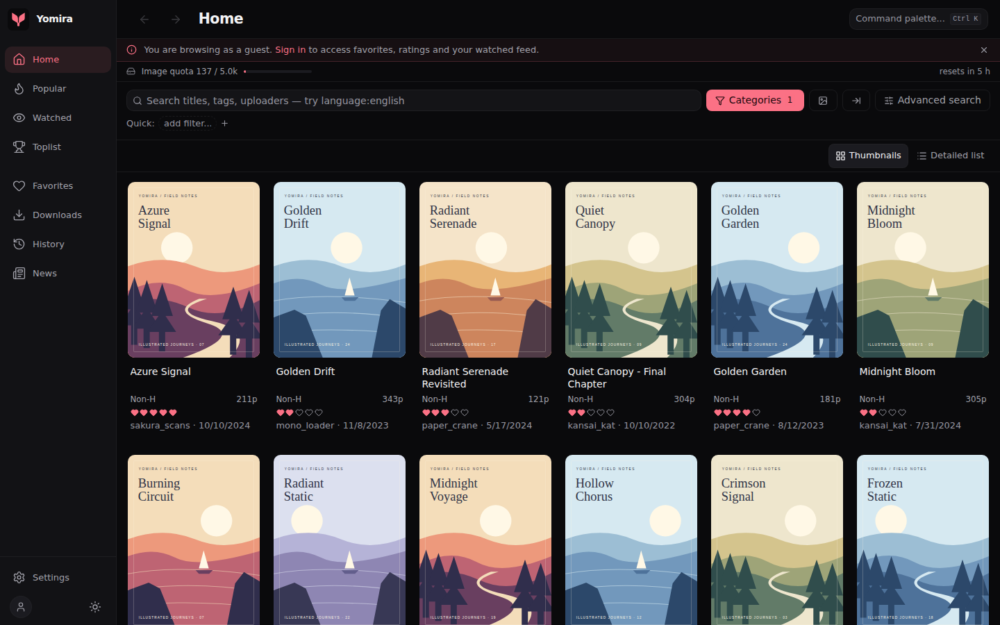
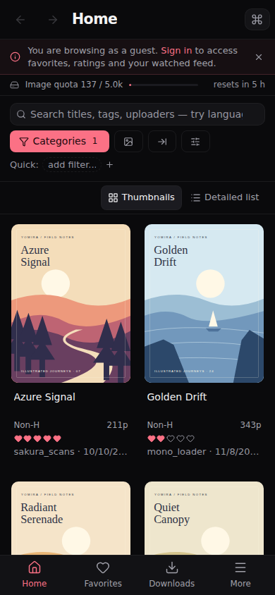
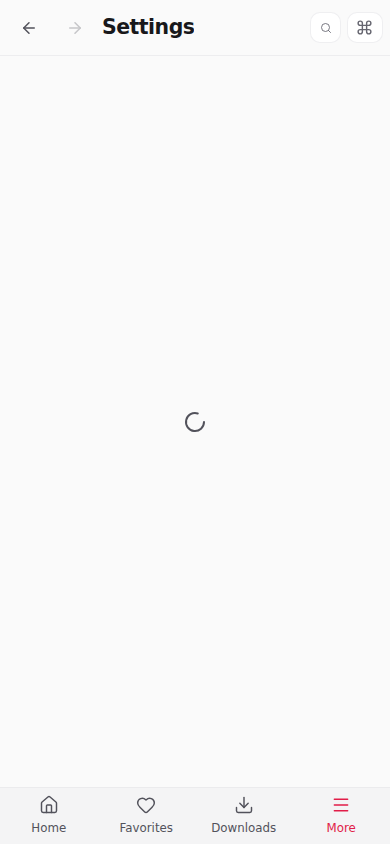

<p align="center">
  
</p>
<h1 align="center">Yomira</h1>
<p align="center">A considered space for browsing and reading.</p>
<p align="center">
  <strong>English</strong> · <a href="README.zh-CN.md">简体中文</a> · <a href="README.ja.md">日本語</a>
</p>
<p align="center">
  <a href="https://github.com/Nya-Foundation/Yomira/actions/workflows/ci.yml">CI</a> ·
  <a href="https://github.com/Nya-Foundation/Yomira/releases">Downloads</a> ·
  <a href="docs/ROADMAP.md">Roadmap</a> ·
  <a href="CONTRIBUTING.md">Contributing</a>
</p>

Yomira is an unofficial E-Hentai / ExHentai client for Android and desktop,
built with Rust, Tauri 2 and React. Inspired by
[Ehviewer_CN_SXJ](https://github.com/xiaojieonly/Ehviewer_CN_SXJ), it brings
familiar gallery workflows to a minimal interface that adapts to touch,
keyboard and mouse.

This project is under active development. It is not affiliated with E-Hentai
or the EhViewer maintainers. The services it accesses contain adult material;
use is restricted to adults of legal age in their jurisdiction.

## Browse, read, keep

- **Find your next read.** Home, Popular, Watched and Toplist browsing;
  thumbnail and detailed list layouts; category, rating and page-count filters;
  image search, multi-tag autocomplete and saved keywords.
- **Explore the details.** Tags and Chinese tag translations, gallery previews,
  ratings, comments, online favorites and favorite notes.
- **Read comfortably.** Paged and continuous modes, swipe navigation,
  right-to-left reading, zoom and pan, adjustable preloading and saved position.
- **Take galleries offline.** A persistent download queue with pause, resume,
  retry and labels. Read saved pages, including partially downloaded galleries,
  without fetching the gallery again.
- **Make it yours.** Light and dark themes, English and Chinese, display scaling,
  desktop back/forward and zoom shortcuts, and Android back navigation.
- **Control the connection.** Proxy, DNS over HTTPS, built-in and custom hosts,
  image resolution preferences and a bounded disk image cache.

Yomira does not yet cover every EhViewer feature. Local favorites, MyTags editing,
backup/import, native Android background-download services and iOS support
remain on the [roadmap](docs/ROADMAP.md). Performance measurements and their
limits are documented in [Performance](docs/PERFORMANCE.md).

## A closer look

These screenshots use synthetic Non-H demo galleries with original, safe-for-work
illustrations. No account data or images from the service are included.



<p align="center">
  
  
</p>

## Get Yomira

Download installable packages from [GitHub Releases](https://github.com/Nya-Foundation/Yomira/releases).

| Platform | Package | Build coverage |
| --- | --- | --- |
| Android 7.0+ | Universal APK: ARM64 and ARMv7 | CI build; signed releases |
| Windows x64 | `.exe` installer | CI build; unsigned |
| Linux x64 | `.deb`, `.AppImage` | Ubuntu 22.04 build baseline |
| macOS | `.dmg` for Apple Silicon and Intel | CI build; unsigned and not notarized |

Build coverage does not replace testing on real devices. See
[Building and signing](docs/BUILDS.md) for prerequisites and platform limitations.

## Develop locally

Install [Tauri's platform prerequisites](https://v2.tauri.app/start/prerequisites/),
Rust (the repository pins 1.92.0), Node.js 24.10+ in the 24.x series, and Bun 1.2.18.

```sh
git clone https://github.com/Nya-Foundation/Yomira.git
cd Yomira
bun install --frozen-lockfile
bun run tauri dev
```

For frontend work, `bun run dev` opens a browser demo with synthetic data.
Native networking and filesystem behavior require the Tauri application.

```sh
bun run build                 # TypeScript checks and production frontend
bun run test:unit             # Frontend unit tests
bunx playwright install chromium
bun run test:e2e              # Browser regressions
cargo test --locked --manifest-path src-tauri/Cargo.toml
```

Desktop packaging: `bun run tauri build`. Android instructions and release
automation are in [BUILDS.md](docs/BUILDS.md) and [RELEASING.md](docs/RELEASING.md).

## Inside the project

```text
src/                    React interface, routes, typed IPC wrappers and state
src-tauri/src/          Rust networking, parsers, persistence and downloads
src-tauri/gen/android/  Maintained Android project and native integration
design/branding/        Canonical logo and icon-generation notes
tests/ + e2e/           Unit, release-tooling and browser regression tests
scripts/               Branding, profiling and release utilities
```

The interface calls Rust through domain wrappers in `src/lib/api/`. Browser
fixtures load only outside Tauri. Rust owns network access, SQLite persistence,
downloads and the image cache. See [Architecture and maintenance](docs/MAINTENANCE.md),
[Design system](docs/DESIGN_SYSTEM.md) and [Offline reading](docs/OFFLINE_READING.md).

App data is stored in platform application directories. Session cookies are
stored locally in `cookies.json`; downloaded galleries and caches are separate
from the source checkout. Legacy application identifiers and `exviewer.db`
are intentionally retained so existing installations keep their data.
Never include cookies or personal galleries in issue reports.

## Credits and license

Yomira builds on the work of **xiaojieonly and the Ehviewer_CN_SXJ contributors**,
and **Hippo Seven and the original EhViewer contributors**. The gallery parsers,
URL construction, client behavior and portions of download and tag handling
were adapted into Rust from that work. Chinese tag lookup uses the translation
distribution maintained by [Mapaler/EhViewer](https://github.com/Mapaler/EhViewer).

The application is distributed under **GPL-3.0-only**. Upstream Apache-2.0
portions retain their original terms and attribution. See [LICENSE](LICENSE),
[NOTICE](NOTICE) and [Third-party notices](THIRD_PARTY_NOTICES.md), including
the licensing details of the exact upstream revision used for the port.

Thank you to the Rust, Tauri, React and wider open-source communities whose
libraries make this project possible.
