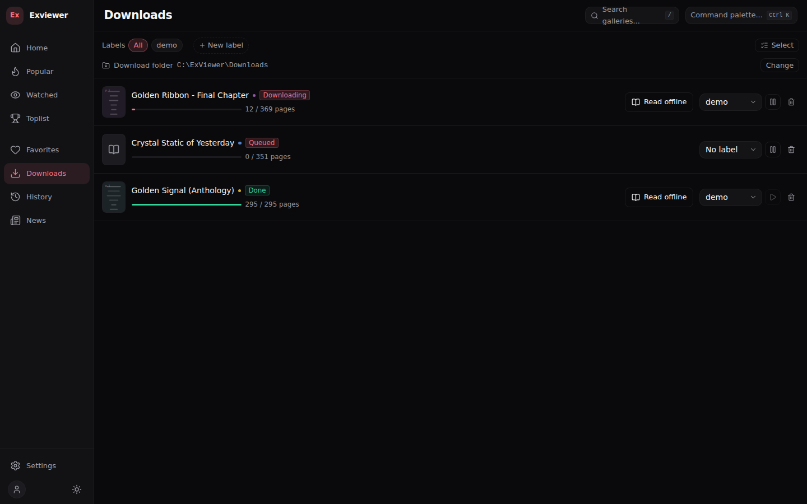
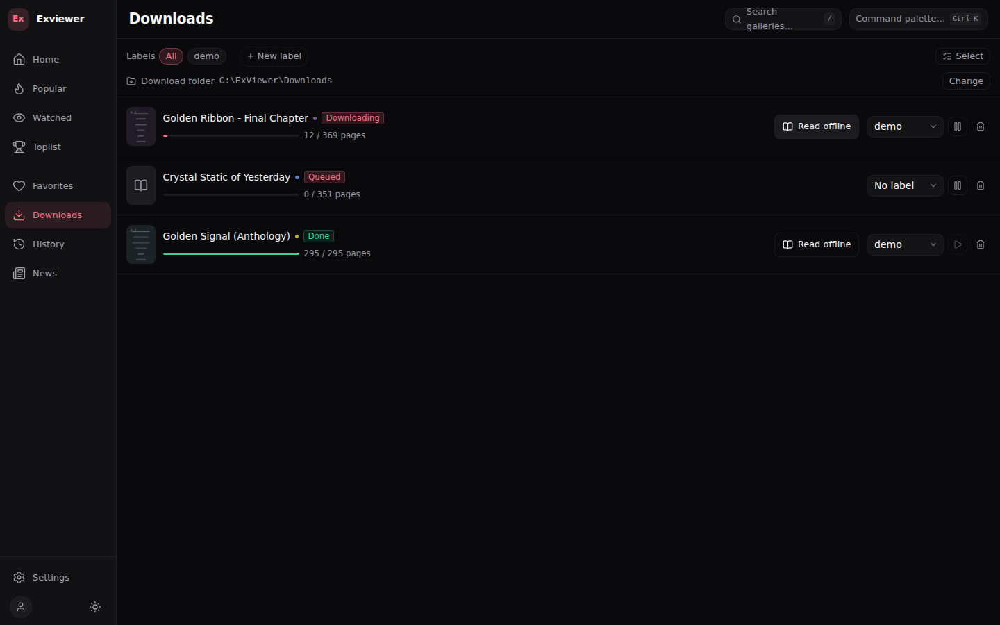

# Offline reading

Implemented 2026-09-07.

## Use it

1. Add a gallery to Downloads while connected and let its pages save.
2. Open **Downloads → Read offline** (or **Resume offline** if you have a saved position). The cover and title also open the offline reader when pages are saved.
3. Close and reopen the app. Return to Downloads to continue from the saved page, including when the site is unreachable or you are signed out.

The toolbar shows how many pages are saved. Paged and continuous modes use the same reading position. Back and Escape return to Downloads.

Partially downloaded galleries remain readable. A missing or unreadable page shows a recovery message and Retry; navigation to other pages remains available. Retry checks local files again. It never silently fetches a missing page from the site. After reconnecting a download drive or resuming the download from Downloads, retry the page. The availability count refreshes on download events, when the app regains focus, and immediately after Retry. Completed galleries are not polled while idle.

Screenshots use synthetic browser fixtures.

## Storage and requests

- SQLite already stores the gallery identity and title; `.ehviewer` stores the page count and download metadata. The reader reuses these durable records, without a database migration or duplicate image storage.
- Saved images stream directly from the download folder through the existing loopback server. Clearing the bounded browsing image cache does not delete downloaded pages.
- Saved-file URLs are registered again on demand after app startup, using the current server port. Local files and missing-file responses use `Cache-Control: no-store`, so retry can observe file restoration or deletion.
- Only explicitly registered image paths within a known gallery folder are exposed. Arbitrary HTTP paths, traversal, and links escaping that folder are rejected.
- Page discovery handles the application's four-digit and upstream's eight-digit filenames, with JPEG, PNG, GIF, WebP and AVIF extensions. Empty files, directories, symbolic links and indices outside the gallery's page count are not reported as saved pages. This is file availability checking, not checksum or image-decode verification; decoding failures are surfaced in the reader.
- The regular online reader also prefers saved page files before its existing network/cache path. Its gallery-detail screen still requires the site; use Downloads for the explicit offline route.
- Reading position uses the existing best-effort local storage, shared with gallery details. Clearing application data clears that position.
- Downloads uses the first saved page as its cover, with a placeholder when page one is unavailable. Queue updates do not rescan every gallery's full file list; the offline reader scans only the gallery being opened.
- New downloads must persist their metadata before entering the queue. Metadata updates replace the header atomically so reading during a download does not see a truncated header. On restart, incomplete former “Done” entries become paused. Resume finds missing indices and keeps later saved files.

## Validation

- Rust integration: download through a fixture source, reopen the database/manager, start a fresh loopback server with an empty cache, and retrieve the original saved bytes. Offline reads make no image-source calls. Coverage includes partial galleries, legacy names, AVIF content type, wrong tokens, missing and restored files, path boundaries, and repair without refetching saved pages.
- Browser tests: open from Downloads, resume after reload, explicit page selection, retry newly available pages, unknown downloads, unreadable image recovery, and continuous reading at a narrow width. Remote HTTP hosts are blocked; local Vite assets remain reachable for reload. These use browser fixtures, not authenticated site downloads.
- Validation passed: production frontend build, 171 Rust tests, 21 Playwright browser tests, and Clippy with warnings denied. Actual image decoding and native packaging across Linux, Windows and macOS still need platform smoke testing with real downloaded galleries.

## Remaining scope

Rich offline detail pages, arbitrary folder/archive import, checksum-based integrity checks, native folder selection, and migration of existing downloads when changing the destination remain separate work. Changing the configured download root still does not move old folders; reconnect or restore the original root to read files stored there. Background account/tag checks elsewhere in the application are separate from the disk-only reader path.
